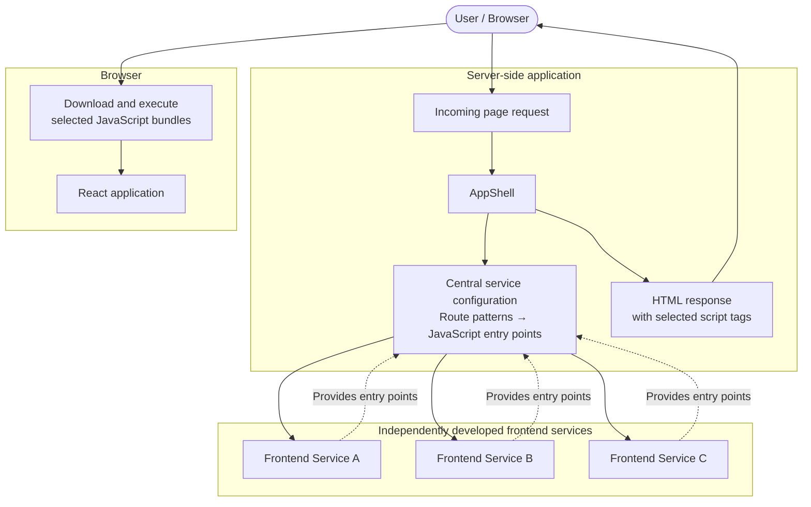

# Modular Frontend Architecture — AppShell

## Overview

This project documents a modular frontend architecture I worked on at **Westwing Group AG**, where we developed a React-based frontend composed of independently maintained frontend services.

The goal was to allow multiple engineering teams to work on separate parts of the frontend while providing users with a consistent application experience.

At the centre of the architecture was **AppShell**: a central application responsible for coordinating frontend services and determining which service bundles should be included when a page was requested.

Rather than maintaining one large frontend application, we separated functionality into smaller, independently developed and deployed frontend services.

This approach helped teams work more autonomously while maintaining a shared application structure.

## Architecture

### AppShell as the central integration layer

AppShell acted as the central integration point between the main application and the independently developed frontend services.

Each frontend service registered its relevant route or URL patterns and corresponding JavaScript entry points in a central configuration.

When a page was requested:

1. The server identified the frontend service responsible for the requested route.
2. It looked up the corresponding JavaScript entry points from the central configuration.
3. The server generated the HTML response with the appropriate script tags included.
4. The browser downloaded and executed the required JavaScript bundles.

This meant that service selection happened on the server side. The browser did not need to dynamically discover frontend services or inject their scripts at runtime.

### System architecture



The diagram illustrates the logical architecture. Only the JavaScript entry points relevant to a particular request were included in the generated HTML.

## Key architectural concepts

### 1. Independent frontend services

Frontend functionality was separated into smaller services that could be developed and maintained independently.

This enabled teams to:
- Work on their own frontend functionality with greater autonomy.
- Maintain separate codebases and release processes.
- Avoid coordinating every frontend change through a single large application.
- Evolve individual parts of the frontend without requiring every team to modify the same codebase.

### 2. Centralized route-to-service configuration

AppShell maintained a central configuration connecting URL patterns to the JavaScript entry points provided by frontend services.

Conceptually, the configuration looked like this:

```ts
interface FrontendService {
  name: string;
  routes: string[];
  entryPoints: string[];
}

const services: FrontendService[] = [
  {
    name: "service-a",
    routes: ["/example/*"],
    entryPoints: ["/service-a/main.js"],
  },
  {
    name: "service-b",
    routes: ["/another-example/*"],
    entryPoints: ["/service-b/main.js"],
  },
];
```

This is an illustrative representation, not the original production configuration.

The central configuration allowed AppShell to determine which frontend bundles were needed for a given request.

### 3. Server-side bundle selection

One important aspect of this architecture was that the server selected the appropriate frontend service before returning the HTML response.

For example:

```text
Request: /example/products

        |
        v

AppShell resolves the route

        |
        v

Find matching frontend service

        |
        v

Retrieve its JavaScript entry points

        |
        v

Generate HTML with corresponding script tags

        |
        v

Browser downloads and executes the bundles
```

This kept the service-selection responsibility within AppShell instead of relying on browser-side runtime discovery.

### 4. Webpack-based bundling

The architecture was built around React and Webpack 2.

Webpack was part of the frontend build pipeline, supporting the separation of frontend code into bundles and the integration of independently maintained frontend services.

The broader frontend engineering practices also included:
- Bundle splitting.
- Tree shaking.
- Code linting.
- Reusable frontend code and shared conventions.

The architecture predates Webpack 5's native Module Federation implementation. The term *Module Federation* is used here in the broader architectural sense of integrating independently developed frontend modules, not to claim that the project used the Webpack 5 ModuleFederationPlugin.

## Architectural benefits

### Team autonomy

Teams could focus on their own frontend services and maintain their own development and deployment workflows.

### Separation of concerns

AppShell handled application-level integration and service selection, while individual frontend services owned their respective functionality.

### More manageable frontend codebases

Breaking down a large frontend into smaller services helped reduce the need for every team to work within the same application codebase.

### Incremental evolution

Individual services could evolve independently, making it easier to introduce changes without requiring a complete frontend rewrite.

## Engineering considerations and trade-offs

A modular frontend architecture introduces additional complexity that needs to be managed.

Some important considerations include:

- **Configuration management:** Route patterns and entry-point mappings must remain accurate as services evolve.
- **Deployment coordination:** The central configuration must reference valid and compatible service bundles.
- **Shared dependencies:** React and other shared libraries need consistent versioning and dependency management.
- **Debugging:** Issues can cross service boundaries, making observability and clear ownership important.
- **Performance:** Bundle size, duplicated dependencies, and the number of scripts loaded for a page should be monitored.
- **Operational reliability:** Independently deployed services introduce more deployment and integration points to maintain.

The architecture therefore trades some operational simplicity for greater separation of ownership and development flexibility.

## My contribution

At Westwing, I was involved in discussions around the frontend service architecture and contributed to its design and implementation.

My experience included:

- Participating in architectural discussions about separating frontend functionality into independently maintained services.
- Working on the React-based AppShell architecture built around Webpack.
- Contributing to the integration approach connecting frontend services through centralized route and entry-point configuration.
- Working with frontend build practices such as bundle splitting, tree shaking, and code linting.
- Collaborating with other engineers and teams on shared frontend architecture and conventions.

The architecture was developed collaboratively. I was part of the engineering discussions and implementation rather than the sole architect of the overall system.

## Technologies and concepts

- React
- JavaScript / TypeScript
- Webpack
- Modular frontend architecture
- AppShell
- Independent frontend services
- Bundle splitting
- Tree shaking
- Server-side route resolution
- Shared frontend conventions

## What this case study demonstrates

This case study demonstrates experience working with a large-scale frontend architecture where multiple teams needed to develop and deploy functionality independently.

It highlights practical experience with frontend modularization, application integration, build tooling, and the organizational challenges of maintaining a shared frontend platform.

It also illustrates an important architectural principle: **the integration layer should coordinate independently owned components without becoming the owner of all their functionality.**